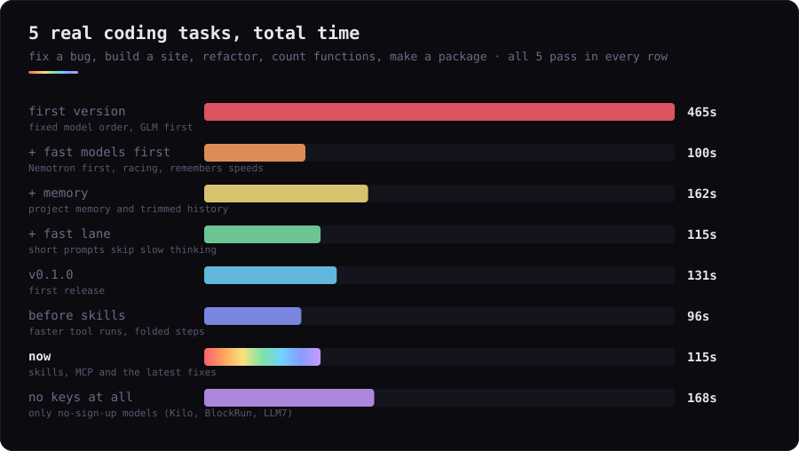
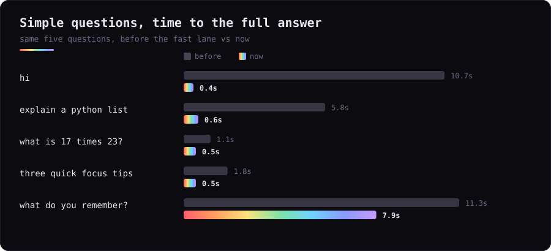
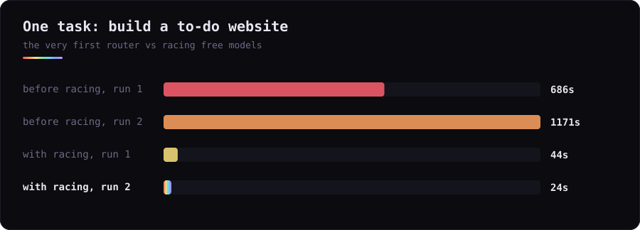

<p align="center"></p>

<h3 align="center">Free AI that codes, beautifully.</h3>
<p align="center">No subscription. No credit card. No account needed.</p>

<p align="center"></p>

Prism is a coding assistant for your terminal that runs entirely on **free AI**. It reads your code, edits files, runs commands and checks its own work.

It runs inside Docker, so it can only touch the one folder you give it.

## Quick start

> **New to Docker?** Follow the [step-by-step setup guide](docs/SETUP.md) for Linux, Mac or Windows. It takes about 10 minutes on Linux, a bit longer on Mac or Windows, and each step shows what you should see.

You only need **Docker** (free). Then one command. It runs [install.sh](install.sh), a short script you can read first:

```bash
curl -fsSL https://raw.githubusercontent.com/sjdsjadjajdjsa/prism/main/install.sh | bash
```

Windows: open the Ubuntu app first (see the Windows steps in [docs/SETUP.md](docs/SETUP.md)) and paste the command there. Mac or Linux: paste it into Terminal.

It checks Docker, downloads Prism to `~/.prism` and adds the `prism` command. Then open a new terminal:

```bash
cd ~/my-project
prism
```

The first start takes a few minutes while Docker builds Prism; later starts are instant.

| System | Status |
| --- | --- |
| Linux (Ubuntu and Ubuntu-based) | tested on Linux Mint 22, which is built on Ubuntu 24.04 |
| macOS | should work with Docker Desktop, not tested yet |
| Windows | should work inside WSL (Ubuntu) with Docker Desktop, not tested yet |

Tried it on Mac or Windows? Please open an issue with how it went.

<details><summary>Install by hand</summary>

```bash
git clone https://github.com/sjdsjadjajdjsa/prism.git
cd prism
./prism install
```
</details>

Then just type what you want: `fix the bug in app.py`, `make me a to-do list website`, `explain this code`.

## Free AI, no setup

A **router** is a small helper that picks a free AI for each step, and a **key** is a secret code you get free from an AI company's website, pasted in with `prism setup`; you don't need a key to start.

Prism works with **no keys at all**. Out of the box it uses free models from Kilo Gateway, BlockRun and LLM7; the router below hides most of the slowness.

Want it faster and smarter? `prism setup` walks you through free keys, about a minute each. None of them ask for a card.

| Provider | What you get | Key |
| --- | --- | --- |
| Kilo Gateway | MiniMax M3.1 Flash, Nemotron Ultra, Laguna | none |
| BlockRun | Nemotron Ultra, Nemotron Lightning | none |
| LLM7 | Codestral | none |
| NVIDIA | Nemotron Ultra and Lightning (fastest), GLM-5.3, GLM-5.3 Flash | free |
| Groq | GPT-OSS 120B, very fast | free |
| Google | Gemini Flash | free |
| Mistral | Codestral | free |
| OpenRouter | free MiniMax and others (50 requests a day) | free |
| Z.ai | GLM-4.7 Flash | free |
| Ollama | any model on your own computer | none |

### How it stays fast

A small router picks the model for every step:

- **Races free models.** If the first one hasn't started answering in a few seconds, the next joins the race, and the first to answer wins.
- **Learns which models are quick** and remembers it between runs.
- **Skips models that are busy or down**, and tries them again later.
- **Fast lane:** on NVIDIA's Nemotron models, short questions skip the slow thinking step.

### Benchmarks

Each row is one run of the same tasks on the same computer. A task only counts if a script confirms the result works.

<p align="center"></p>
<p align="center"></p>
<p align="center"></p>

Free models are shared, so the same run can be 30% faster or slower on another day. Compare rows loosely. The raw numbers are in [bench/history.json](bench/history.json), `python3 bench/chart.py` redraws the charts, and `bench/run.sh` and `bench/chat.sh` measure your own setup.

## Skills

Skills are short playbooks Prism follows for common jobs. It picks the right one by itself. `/skills new <name>` creates a new one.

| Skill | For |
| --- | --- |
| `website` | a polished site, checked before it says done |
| `fix-bug` | reproduce, find the cause, smallest fix, prove it |
| `python-project` | a new Python project with a venv and tests |
| `web-app-node` | a small Node app with npm scripts |
| `explain-code` | a plain-words tour of a codebase, no changes |
| `git-basics` | safe git: .gitignore, small commits, no secrets |
| `refactor` | restructure without changing behaviour |
| `computer-help` | troubleshooting a Linux computer, asking before changes |
| `browser-game` | a small canvas game with a game loop and input |
| `discord-bot` | a Python discord.py bot skeleton with a slash command |
| `automate-task` | a Python script to automate file chores with dry-run |
| `portfolio-site` | a personal resume or portfolio page with print CSS |
| `learn-mode` | teach by building in small steps with explanations |

`/skills` lists them. Add your own as `.prism/skills/<name>.md` in a project or `~/.config/prism/skills/<name>.md`. See [cli/skills/README.md](cli/skills/README.md) for the format.

## Tools and plugins (MCP)

Prism can connect MCP servers to give the AI extra tools such as file access, web pages, git, a browser or GitHub. Add a `.prism/mcp.json` like this to connect the filesystem server:

```json
{
  "mcpServers": {
    "filesystem": {
      "command": "npx",
      "args": ["-y", "@modelcontextprotocol/server-filesystem", "/workspace"]
    }
  }
}
```

Type `/mcp` to see what is connected. Put the same file in `~/.config/prism/mcp.json` to use a server in every project. See [docs/MCP.md](docs/MCP.md) for more.

## Computer help

```bash
prism fix
```

Prism normally lives in a Docker box and can't see your computer. `prism fix` runs it on your computer instead, so it can find out why the Wi-Fi drops, the disk is full or an app won't start. It looks around with read-only commands, explains what it finds in plain words, and **asks you before every command or file change** (`y` allow, `n` no). Tested on Linux; Mac should work but hasn't been tried yet.

<p align="center"></p>

## In your browser

```bash
prism web
```

The same Prism, Shard and beam included, in your browser. It opens by itself; the address is printed in the terminal (usually http://127.0.0.1:4849, but the exact port is printed in the terminal). It only listens on your own computer.

<p align="center"></p>

Inside the terminal app, `/web` moves the current chat to your browser (same history and memory). Close the tab or press enter in the terminal to come back, and everything done in the browser is there. The browser version now understands the same slash commands, with the same suggestion list.

## Memory

- **`PRISM.md`**: rules for your project that Prism always follows. `/init` writes one for you. It also reads `AGENTS.md` and `CLAUDE.md`.
- **Automatic memory**: after each task Prism saves what it learned about the project, so a new chat already knows how your project works. `/memory` shows it, `/memory forget` clears it.
- **Every chat is saved.** `/resume` reopens one, `prism continue` picks up the last.
- **Saves free usage**: old file reads are trimmed and long chats are summarized, keeping your latest request word for word. `/usage` shows what you used today.

## Commands

| In the terminal | |
| --- | --- |
| `prism` | start in the current folder |
| `prism <folder>` | start in that folder |
| `prism continue` | reopen the last chat here |
| `prism web [folder]` | open Prism in your browser |
| `prism fix` | computer help mode, asks before every change |
| `prism setup` | add free keys (optional) |
| `prism status` | which free models are ready |
| `prism logs` | watch which model answers each step |
| `prism stop` | stop the background router |
| `prism install` | add the `prism` command to your terminal |

| Inside Prism | |
| --- | --- |
| `enter` / `shift+enter` | send / new line |
| `esc` | stop the AI |
| `ctrl+c` or `/quit` | close Prism |
| `ctrl+t` or `/theme` | switch theme (prism, tokyo-night, catppuccin, rose-pine, matte-black, gruvbox, nord, everforest) |
| `pgup` `pgdown`, mouse wheel | scroll (smooth, with a scrollbar) |
| click a `▸ N steps` line | open folded steps from an earlier turn (`ctrl+o` opens all of them) |
| `/` | list every command, `tab` completes |
| `/models` `/new` `/resume` `/init` `/skills` `/mcp` `/memory` `/usage` `/beam` `/quiet` `/web` `/help` `/quit` | |

## Meet Shard

<p align="center"></p>

Shard is Prism's mascot. He reacts to what the AI is doing: thinking, working, done, or waiting when every free model is busy. When a task with real steps finishes, he fires the Last Prism beam:

<p align="center"></p>

`/beam` turns the beam on or off, and `/quiet` hides Shard's one-line comments.

## Safety and privacy

- Prism only sees the folder you start it in, and won't start in your home folder or `/`. The one exception is `prism fix`, which you start on purpose: it runs on your computer and asks before every change.
- Commands run inside the Docker box, not on your computer. Files it creates belong to you.
- Keys live in `keys.conf`, readable only by you and ignored by git.
- The router only listens on `127.0.0.1`, so other devices on your network can't use it.
- **Free AI services may keep what you send them.** Don't paste passwords or private data.

## How it's built

| Path | What it is |
| --- | --- |
| `prism` | the command you run |
| `install.sh` | the one-line installer |
| `cli/` | the Prism app, in Go with Charm's Bubble Tea (`cli/skills/` holds the built-in skills) |
| `web/` | the browser version (`prism web`) |
| `router/` | the free-model router (`providers.json` is the model list) |
| `agent/` | the Docker image Prism runs in |
| `bench/` | the speed and correctness tests |

**Networking:** on first run Prism checks whether Docker's normal network can reach the internet. Some Linux firewalls block it; then Prism shares the computer's network instead (`docker-compose.host.yml`). The choice is saved in `.network`; delete it to check again.

## Thanks

Prism borrows ideas from OpenCode, Crush, jcode, Claude Code and Codex. Its look is built on [Charm](https://charm.land)'s open-source libraries and inspired by [Omarchy](https://omarchy.org). The beam is named after the Last Prism from Terraria; the art and lines are original.

## License

MIT. See [LICENSE](LICENSE). What changed in each version: [CHANGELOG.md](CHANGELOG.md).
