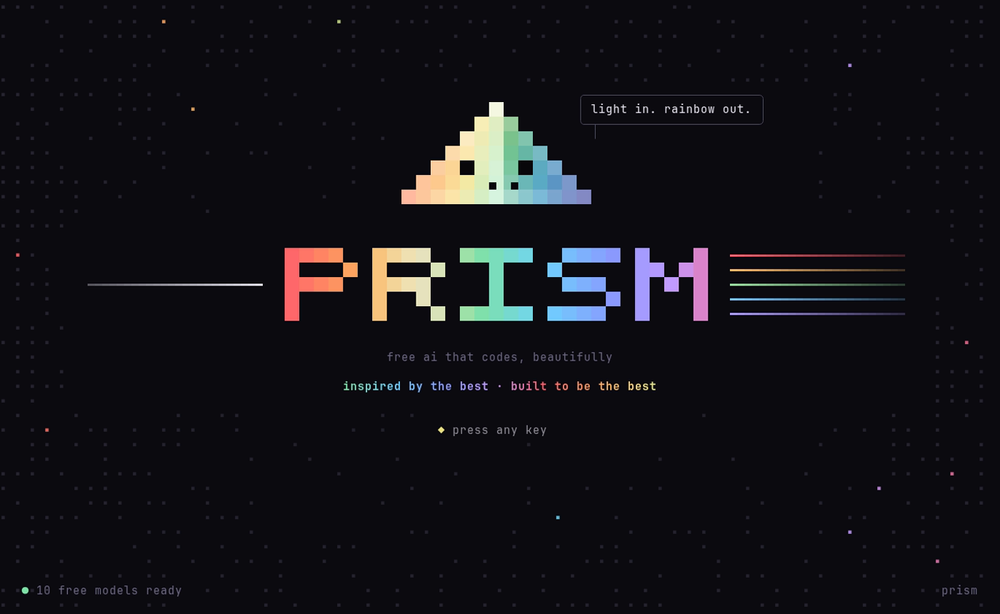
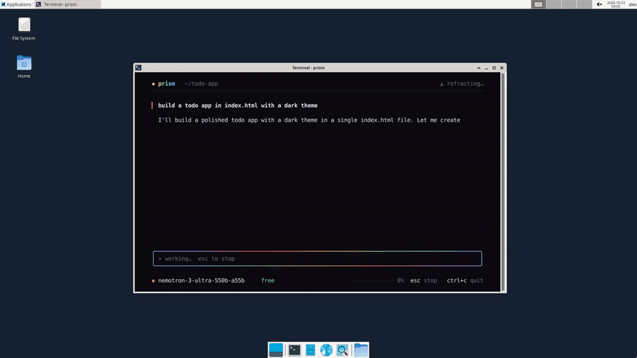
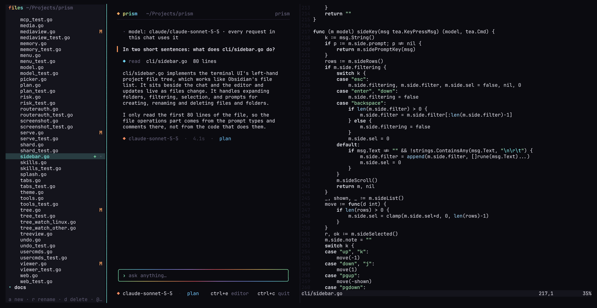
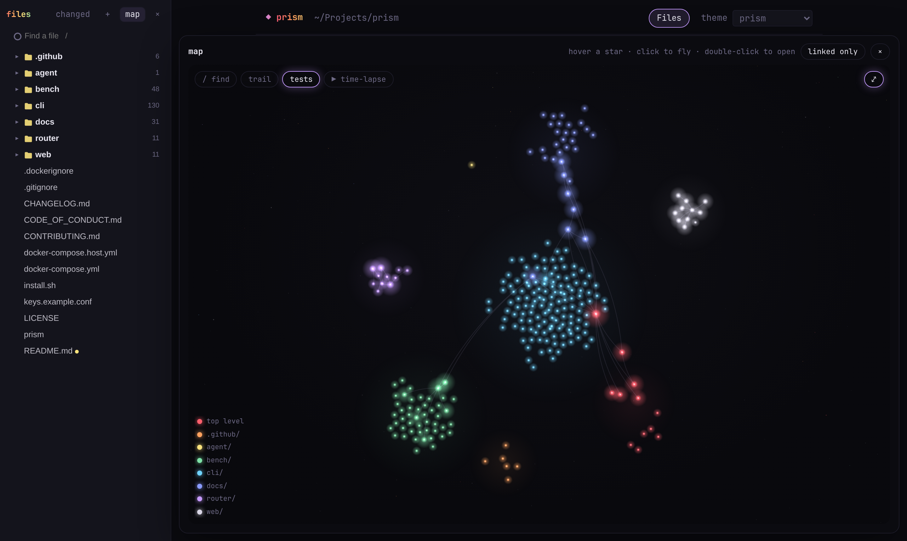
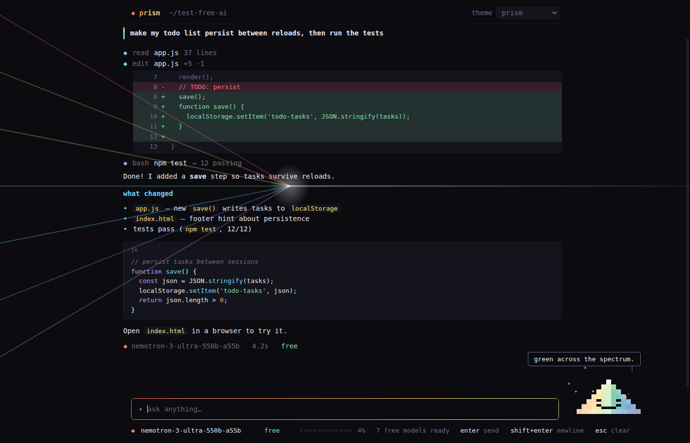
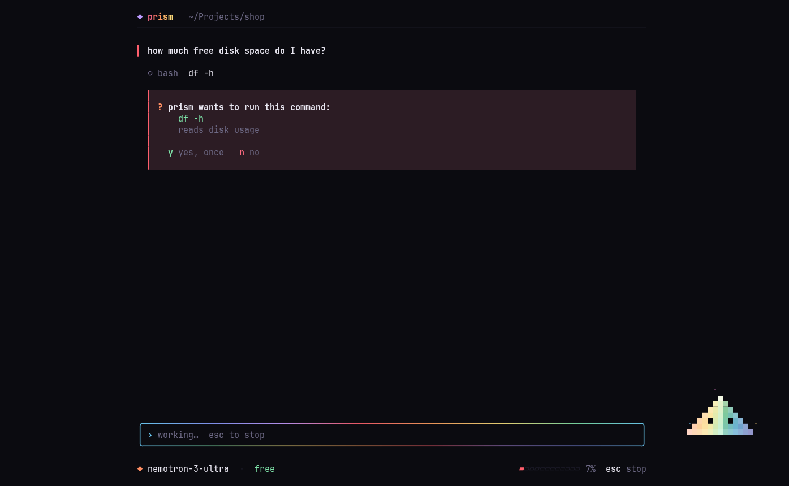
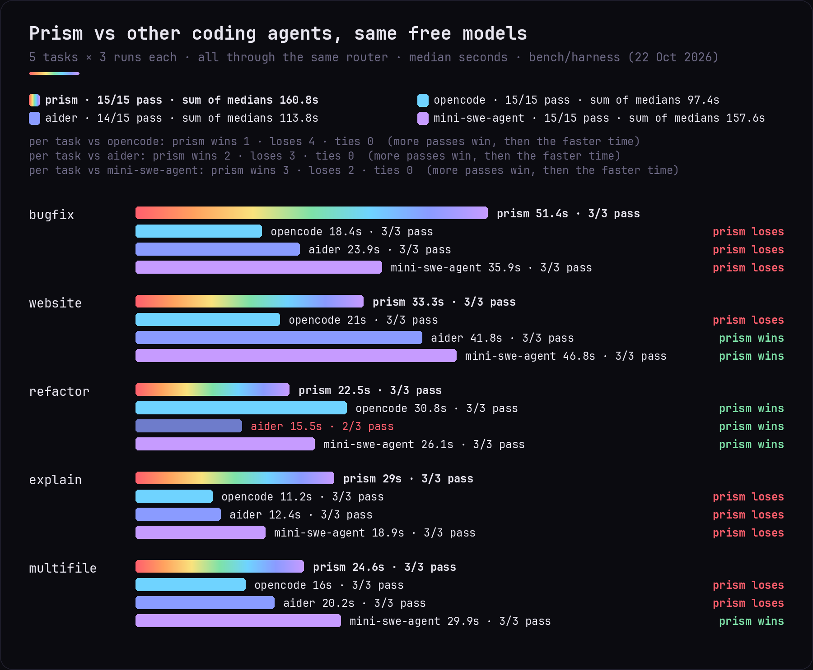

<p align="center"></p>

<h3 align="center">Free AI that codes, beautifully.</h3>

<p align="center">A coding assistant for your terminal and browser that runs on free AI models,<br>or on the ChatGPT, Claude, Grok, Gemini or Copilot plan you already pay for.</p>

<p align="center">
  <a href="https://github.com/sjdsjadjajdjsa/prism/releases/latest"></a>
  <a href="https://github.com/sjdsjadjajdjsa/prism/actions/workflows/check.yml"></a>
  <a href="LICENSE"></a>
  
</p>

<p align="center">
  <a href="#get-started">Get started</a> ·
  <a href="#features">Features</a> ·
  <a href="docs/GUIDE.md">Guide</a> ·
  <a href="docs/BENCHMARKS.md">Benchmarks</a> ·
  <a href="CHANGELOG.md">Changelog</a> ·
  <a href="CONTRIBUTING.md">Contributing</a>
</p>

<p align="center"></p>

Prism reads your code, edits files, runs commands and checks its own work. When it builds a web page, it opens it in a hidden browser and clicks through it like a person before it calls it done. It runs inside Docker, so it can only touch the one folder you give it.

No subscription, no credit card, no account.

## Get started

You need [Docker](https://docs.docker.com/get-docker/). New to it? The [setup guide](docs/SETUP.md) walks you through Linux, macOS and Windows.

```bash
curl -fsSL https://raw.githubusercontent.com/sjdsjadjajdjsa/prism/main/install.sh | bash
```

The [installer](install.sh) checks Docker, downloads Prism to `~/.prism` and adds the `prism` command. Open a new terminal, then:

```bash
cd ~/my-project
prism
```

The first start builds Prism, which takes a few minutes. After that it opens in seconds. Ask for anything: *make a snake game I can play in the browser*, *fix the bug in app.py*, *explain this code*.

| Platform | Status |
| --- | --- |
| Linux (Ubuntu, Mint, Debian) | tested |
| Linux (Arch, CachyOS, Omarchy) | tested |
| Windows 11 (WSL with Docker Desktop) | tested · [beginner guide](docs/WINDOWS.md) |
| macOS (Docker Desktop) | should work, not tested yet |

<details>
<summary>Install from source</summary>

```bash
git clone https://github.com/sjdsjadjajdjsa/prism.git
cd prism
./prism install
```
</details>

## Features

**Free by default.** A small router picks a free model for every step, races them so you aren't stuck waiting, and skips the ones that are busy. No key needed to start; `prism setup` adds free keys for more speed. [Providers →](docs/GUIDE.md#free-ai-no-setup)

**Your own plan, if you have one.** `/login` signs in to ChatGPT, Claude, Grok, Gemini or Copilot. Plan models only answer when you pick them, so free mode never spends your plan. [Plans →](docs/GUIDE.md#use-the-plan-you-already-pay-for)

**Checks its own work.** Runs your tests, opens web pages it builds and clicks through them, and asks before risky commands like deleting folders or pushing. [Safety →](docs/GUIDE.md#asks-before-risky-commands)

**Talk to it while it works.** Enter sends a correction it picks up before its next step, alt+enter queues the next message, esc stops. `/plan` makes it plan before it touches anything.

**Files, editor and map.** A file tree beside the chat (ctrl+b), an editor that works like a notes app (ctrl+e) or Neovim, pictures and videos right in the terminal, and a constellation map of how your files link. [Files →](docs/GUIDE.md#files-and-the-editor)

**Helpers, skills and tools.** Ask for helpers and Prism splits the work between them. 24 built-in skills, your own saved commands and hooks, and tool servers (MCP). [Crew mode →](docs/GUIDE.md#crew-mode-helper-agents)

**Terminal or browser.** `prism web` (or `/web` mid-chat) opens the same chat in your browser, with the same history.

**Remembers your project.** `PRISM.md` rules, automatic memory between chats, and every chat saved to pick up later.

<table>
  <tr>
    <td width="50%"></td>
    <td width="50%"></td>
  </tr>
  <tr>
    <td align="center"><sub>Tree, chat and editor in the terminal</sub></td>
    <td align="center"><sub>The constellation map</sub></td>
  </tr>
  <tr>
    <td width="50%"></td>
    <td width="50%"></td>
  </tr>
  <tr>
    <td align="center"><sub>The same chat in your browser</sub></td>
    <td align="center"><sub>It asks before risky commands</sub></td>
  </tr>
</table>

## Benchmarks

Four coding agents ran the same five tasks on the same free models, and a task only counts if a script confirms the result works. Prism, opencode and mini-swe-agent passed all 15 runs; Aider passed 14. Free models are shared, so times vary from day to day.

<p align="center"></p>

Method, every run and more charts: [docs/BENCHMARKS.md](docs/BENCHMARKS.md).

## Documentation

| | |
| --- | --- |
| [Guide](docs/GUIDE.md) | every feature and command in detail |
| [Setup](docs/SETUP.md) · [Windows](docs/WINDOWS.md) | installing Docker and Prism, step by step |
| [Tool servers](docs/MCP.md) | connecting MCP servers |
| [Architecture](docs/ARCHITECTURE.md) | how the code fits together |
| [Benchmarks](docs/BENCHMARKS.md) | speed and correctness, with method |
| [Changelog](CHANGELOG.md) | what changed in each version |

## Privacy

Prism only sees the folder you start it in, and its commands run inside Docker. Keys and sign-ins stay on your computer, and the router only listens on `127.0.0.1`. Free AI services may keep what you send them, so don't paste passwords or private data. [More →](docs/GUIDE.md#safety-and-privacy) · [Report a security problem](SECURITY.md)

## Contributing

Bug reports, platform reports and new free providers are welcome. See [CONTRIBUTING.md](CONTRIBUTING.md), and please follow the [code of conduct](CODE_OF_CONDUCT.md).

## Thanks

Built with [Empryo](https://empryo.com). Ideas from [OpenCode](https://opencode.ai), [Crush](https://github.com/charmbracelet/crush), [jcode](https://jcode.sh), [Claude Code](https://www.anthropic.com/claude-code) and [Codex](https://github.com/openai/codex); measured against [Aider](https://aider.chat) and [mini-swe-agent](https://github.com/SWE-agent/mini-swe-agent). The look is built on [Charm](https://charm.land)'s [Bubble Tea](https://github.com/charmbracelet/bubbletea) and inspired by [Omarchy](https://omarchy.org).

Free thanks to [NVIDIA](https://build.nvidia.com), [Groq](https://groq.com), [Mistral](https://mistral.ai), [Google Gemini](https://ai.google.dev), [OpenRouter](https://openrouter.ai), [Kilo](https://kilo.ai), [BlockRun](https://blockrun.ai), [LLM7](https://llm7.io), [Z.ai](https://z.ai) and [Ollama](https://ollama.com). The beam is named after the [Last Prism](https://terraria.wiki.gg/wiki/Last_Prism) from [Terraria](https://terraria.org); the art is original.

## License

[MIT](LICENSE)
